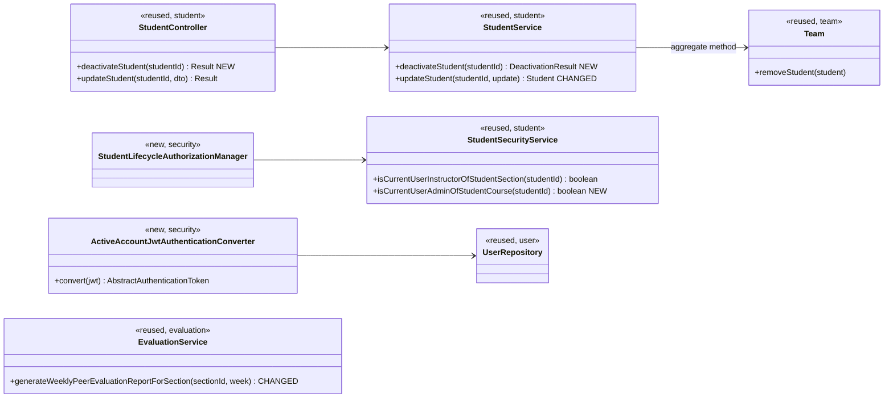
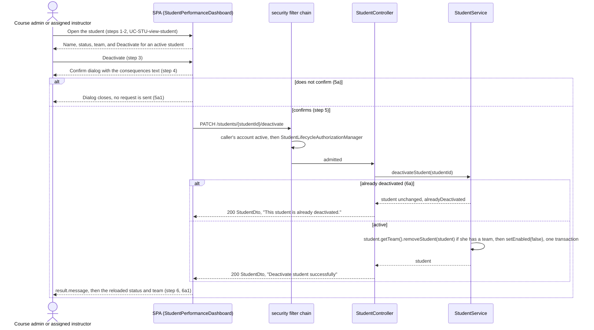
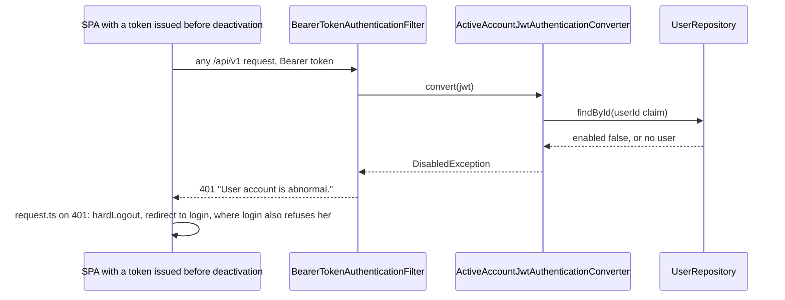
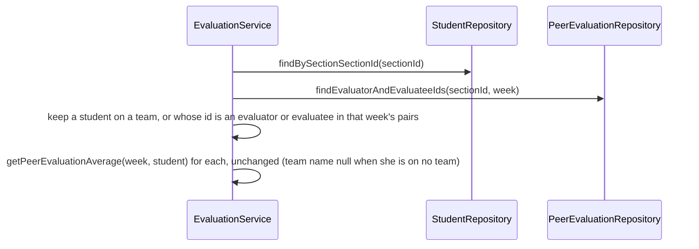

# Student (STU) Design

> Realizes: UC-STU-deactivate-student
> Depends on: FR-SEC-active-account, FR-SEC-deny-unauthorized, BR-student-lifecycle, BR-team-admin-only (its deactivation exception), BR-team-assignment-required, BR-submission-owed, BR-section-scoped-access; changes how UC-EVA-section-evaluation-report selects its students
> See: [use cases](../requirements/use-cases.md#student), [SRS security FRs](../requirements/software-requirements-specification.md#security-and-authorization-requirements), [architectural-design.md](architectural-design.md#security--compliance) (foundation component view, Authorization)
> Designed against `main` at `59f0267` (2026-10-29).

## Overview

A course admin or an assigned instructor deactivates a student who has left the course section. Deactivation turns her account off and removes her from her team. Her weekly activity reports and peer evaluations stay. The work lives in the foundation `student` slice: a dedicated endpoint replaces the generic edit path for deactivation. Two cross-cutting changes come with it. Every bearer request now re-checks that the caller's account is active (FR-SEC-active-account), so deactivation takes effect at once. The section peer evaluation report now keeps a student who has left her team for the weeks she took part in.

Before this design, deactivation was the `enabled` field on `PUT /students/{studentId}` and the Status dropdown in `EditStudentForm.vue`. That path had no confirmation, left the student on her team, admitted the student herself at the route, refused a course admin not assigned to the course section, and let a deactivated student's token keep working for up to 2 hours.

## Components & classes

- **`student` (changed):**
  - [`StudentController`](../../backend/src/main/java/team/projectpulse/student/StudentController.java) adds `PATCH /{studentId}/deactivate`.
  - [`StudentService`](../../backend/src/main/java/team/projectpulse/student/StudentService.java) adds `deactivateStudent`, which returns a `DeactivationResult(Student student, boolean alreadyDeactivated)` record; the controller picks the message from the flag. It calls `studentRepository.save` explicitly after the change. `Team.removeStudent` removes her from the team's list and nulls `Student.team`, the owning side, so the save persists the removal.
  - `updateStudent` refuses a change of `enabled` from true to false for every caller, whatever her role.
  - [`StudentSecurityService`](../../backend/src/main/java/team/projectpulse/student/StudentSecurityService.java) adds `isCurrentUserAdminOfStudentCourse`. It is true when the course admin of the student's course section's course is the caller (`UserUtils.getUserId()`), with no role check, and false for an unknown id, like its siblings. The existing `isCurrentUserInstructorOfStudentSection` checks the instructors assigned to the student's course section, not her team's instructor, so it admits an assigned instructor for a student on no team.
- **`security` (new):**
  - `authorizationmanagers/StudentLifecycleAuthorizationManager` reads `studentId` and admits `isCurrentUserInstructorOfStudentSection || isCurrentUserAdminOfStudentCourse`. UC-STU-reactivate-student will reuse it.
  - `ActiveAccountJwtAuthenticationConverter` wraps the converter the existing `jwtAuthenticationConverter` bean builds in [`SecurityConfiguration`](../../backend/src/main/java/team/projectpulse/security/SecurityConfiguration.java). After delegating, it loads the `userId` claim's user and throws `DisabledException` if she is missing or not enabled. `CustomBearerTokenAuthenticationEntryPoint` hands that exception to the `HandlerExceptionResolver`, so `ExceptionHandlerAdvice`'s `AccountStatusException` handler writes the `401` `Result` envelope.
  - HTTP Basic login already refuses a disabled account: the `DaoAuthenticationProvider` checks `MyUserPrincipal.isEnabled`. No change.
  - The route rule `PATCH ${base}/students/{studentId}/deactivate` goes in the `/students` block of `SecurityConfiguration`. No broader `/students/**` matcher exists there, so no rule shadows it.
- **`evaluation` (changed):** [`EvaluationService.generateWeeklyPeerEvaluationReportForSection`](../../backend/src/main/java/team/projectpulse/evaluation/EvaluationService.java) selects its students differently (see *Sequence*). It reuses `PeerEvaluationRepository.findEvaluatorAndEvaluateeIds`.
- **Reused unchanged:**
  - `Team.removeStudent`, the call `TeamService.assignStudentToTeam` already makes.
  - `ExceptionHandlerAdvice`'s `AccountStatusException` mapping to `401`.
  - `CustomBearerTokenAuthenticationEntryPoint`.
- **Frontend:**
  - `apis/student/index.ts` adds `deactivateStudent(id)`.
  - [`StudentPerformanceDashboard.vue`](../../frontend/src/pages/students/StudentPerformanceDashboard.vue) is the page UC-STU-view-student opens. It shows the student's status and team (`StudentDto` already carries `teamId` and `teamName`). For an active student it shows a Deactivate button to any instructor or course admin, and the server decides who is admitted; a refused click lands on the forbidden page, as every `403` does. The button opens `ElMessageBox.confirm` with this text: "Deactivate <name>? She will no longer be able to log in or submit weekly activity reports or peer evaluations, and she will be removed from her team. Her account and submitted work are kept. Reactivating her later does not put her back on a team." On success it shows `result.message` and reloads the student.
  - [`Students.vue`](../../frontend/src/pages/students/Students.vue) labels the status tag Active / Deactivated.
  - [`EditStudentForm.vue`](../../frontend/src/pages/students/EditStudentForm.vue) disables the Deactivated option while the student is active.

## Sequence

### UC-STU-deactivate-student: main success scenario, 5a and 6a

### FR-SEC-active-account: a deactivated user's next request

### UC-EVA-section-evaluation-report: which students the report lists

## API contract

| Endpoint or job | Caller (who may) | Request | Success | Errors, by extension |
|---|---|---|---|---|
| `PATCH /api/v1/students/{studentId}/deactivate` | The course admin of the student's course, whether or not she is assigned to the course section, or an instructor assigned to the student's course section (BR-student-lifecycle): `StudentLifecycleAuthorizationManager`, a route rule added before the `denyAll()` catch-all | No body | `200`, the `StudentDto` (`enabled: false`, no team), message "Deactivate student successfully". 6a: `200`, the unchanged `StudentDto`, message "This student is already deactivated." | Any student (herself included), an unassigned instructor, or another course's admin: `403` (FR-SEC-deny-unauthorized). An unknown `studentId`: `403`, since the manager fails closed before the service runs. 5a sends no request |
| `PUT /api/v1/students/{studentId}` (changed) | Unchanged (`UserOwnershipAuthorizationManager`) | Unchanged | Unchanged. `enabled: true` still reactivates, until UC-STU-reactivate-student replaces that path | An instructor sending `enabled: false` for an active student: `400` `INVALID_ARGUMENT`, "Deactivate a student with the Deactivate action.", nothing saved. `enabled: false` for a student already deactivated is not a change and passes |
| Every bearer-authenticated `/api/v1/**` request (changed) | Any token holder | Unchanged | Unchanged | The token's user is deactivated or no longer exists: `401` `UNAUTHORIZED`, "User account is abnormal." (FR-SEC-active-account) |
| Section peer evaluation report (route unchanged) | Unchanged | Unchanged | Lists every student on a team in the course section, and also any student who evaluated or was evaluated that week, whether or not she is on a team or active now | Unchanged |

## Key decisions

**A dedicated endpoint, and the edit path refuses deactivation.** BR-student-lifecycle allows deactivation only through deactivation, which carries its own route guard and the step 4 confirmation. `PUT` keeps `enabled: true` so a student can still be reactivated until UC-STU-reactivate-student is built (its Associated Information says so). Rejected: deactivating through `PUT`. Its guard admits the student herself and refuses an unassigned course admin, it overwrites name and email from the body, and it has no confirmation. Rejected: dropping `enabled` from `PUT` now, which would leave no way to reactivate.

**Team removal through the `Team` aggregate, not `TeamService`.** `StudentService` calls `student.getTeam().removeStudent(student)`, the call `TeamService.assignStudentToTeam` makes when it moves a student. Rejected: calling `TeamService.removeStudentFromTeam`. `team` already reads `StudentRepository`, so a `student` → `team` service call would make a cycle (`MNT-feature-locality`). It would also borrow the rights of a route an instructor may not call; BR-team-admin-only's exception gives her team removal only as part of deactivation.

**One transaction.** Team removal and `enabled = false` are made in the same `@Transactional` service call, so a failure leaves her neither deactivated-but-on-a-team nor removed-but-active. Rejected: two requests from the SPA (remove, then deactivate), which can stop halfway.

**6a answers `200` with its own message.** The student ends up in the state the user asked for, so it is not an error. The SPA shows `result.message` either way and needs no branch. Rejected: `409`, which reports a failure for the requested outcome and invites a retry.

**Re-check the account on every request.** `ActiveAccountJwtAuthenticationConverter` does one primary-key read per bearer request and refuses a deactivated or deleted user, students and instructors alike (BR-instructor-lifecycle). Rejected: waiting for the 2-hour token to expire, which breaks FR-SEC-active-account and lets a withdrawn student submit. Rejected: a token version or revocation list, which needs a schema change for a problem that is only about account status. TD-jwt-revocation stays open for leaked tokens.

**Authorization keys on the student.** A new manager composes the existing assigned-instructor check with a new owning-course-admin check, both keyed on `studentId`. This is the same `anyOf` shape NOT uses for `sectionId`. Rejected: `UserOwnershipAuthorizationManager`, which admits the student herself. Rejected: `AuthorizationManagers.anyOf` over existing managers, since none checks a student's course admin.

**The section report widens, not narrows.** It keeps current team members (so a member with no evaluations that week still shows, as today) and adds anyone in that week's evaluator–evaluatee pairs. `findEvaluatorAndEvaluateeIds` is scoped by the evaluator's course section, and a deactivated student keeps her course section. Rejected: the current-team filter, which drops a removed or deactivated student from every past week. Rejected: every student in the course section, which would list never-assigned students with empty rows. This also fixes the same gap for UC-TEA-remove-student.

**Who owes is decided as of now, not as of the week.** BR-submission-owed counts a student's *current* team and *active* account, and `SubmissionStatusService` applies it that way. So once she is deactivated, she drops out of the "has not submitted" lists for every week, past ones included, and her former teammates stop owing her an evaluation for those weeks too. The evaluations already written still show in the report. Rejected: reconstructing team membership as it was in each week, which needs a membership history the data model doesn't keep.

**No locking for 6a.** Two deactivations at the same moment can both report success instead of one reporting 6a. The end state is the same, so no version column is added.

**No email to the student.** The use case names none, unlike reactivation's step 6.

## Data model

No delta. `PeerEvaluationUser.enabled` and the optional `Student.team` already exist, as the SRS's [Business Domain Model](../requirements/software-requirements-specification.md#business-domain-model) describes. Removing her from her team nulls `Student.team`. Her `Activity` and `PeerEvaluation` rows keep their own team and week references, so nothing else moves.

## Reuse & cross-cutting

- Authorization: the existing route-rule pattern ([Authorization](architectural-design.md#authorization)); `StudentSecurityService` checks return false rather than throw.
- Error envelope: `AccountStatusException` already maps to `401` through `ExceptionHandlerAdvice`. The service's refusal on `PUT` is an `IllegalArgumentException`, which maps to `400` `INVALID_ARGUMENT`.
- Who owes: BR-submission-owed already excludes students on no team and deactivated students (`SubmissionStatusService`, [not.md](not.md)), so nothing in `notification` changes.
- Peer evaluation submission: `EvaluationService.addPeerEvaluation` already refuses an evaluatee who is not on the evaluator's team, which covers a former teammate.
- Document-section locks a deactivated student held lapse by BR-lock-expiry.

## Tests

Fixtures come from the `dev` seed, adjusted inside each test's transaction (rolled back afterward). Section 2 belongs to course 1, whose course admin Bingyang is also assigned to it, as is Bill. For the course-admin test, unassign Bingyang from section 2. For the unassigned-instructor test, unassign Bill. Tim, course 3's admin, is another course's admin. For a deactivated instructor, disable Bill. The history tests use a team 1 student and an earlier seeded week that has peer evaluations both of her and by her.

| Use case, flow | Level | Asserts |
|---|---|---|
| UC-STU main, assigned instructor | integration | Bill deactivates a student on a team: `200`; in the database `enabled` is false and her team is null; her activities and peer evaluations remain |
| UC-STU main, course admin | integration | The owning course admin who is not assigned to the course section: `200` |
| UC-STU 5a | E2E (Cypress, API stubbed) | Cancelling the confirm dialog sends no `PATCH` |
| UC-STU 6a | integration | A second `PATCH`: `200`, message "This student is already deactivated.", database unchanged |
| UC-STU step 6 | E2E (Cypress, API stubbed) | Confirm sends one `PATCH` and shows `result.message`; a deactivated student shows no Deactivate button |
| UC-STU denied (FR-SEC-deny-unauthorized) | integration | The student herself, another student, an unassigned instructor, and another course's admin each get `403` with the `Result` envelope; an unknown id gets `403` |
| FR-SEC-active-account | integration | A token issued before deactivation gets `401` on its next `GET` and on a WAR `POST`; a deactivated instructor's token gets `401` |
| FR-SEC-active-account, login | integration | A deactivated student's login: `401` |
| BR-student-lifecycle, edit path | integration | `PUT` with `enabled: false` on an active student: `400`, still active. `PUT` with `enabled: true` on a deactivated student: `200`, active. `PUT` changing a deactivated student's name: `200` |
| Past reports kept | integration | After deactivation, the section report for an earlier week lists her with her teammates' evaluations of her, and her evaluations still count in her teammates' averages; a later week does not list her and no one owes her an evaluation |
| Former teammate evaluates her | integration | After deactivation, a former teammate's `POST` of a peer evaluation of her: `400` `INVALID_ARGUMENT`, "The evaluator and evaluatee must be on the same team.", nothing saved |
| Report, member with no evaluations | integration | A student on a team who neither evaluated nor was evaluated that week still appears in the section report, with an empty average |
| Service | unit | `deactivateStudent` removes her from her team and disables her; a student on no team is only disabled; an unknown id throws `ObjectNotFoundException` |
| Atomicity | integration | With `StudentRepository.save` made to throw (`@MockitoSpyBean`), the `PATCH` fails, and a fresh read shows her still enabled and on her team. The test opts out of the base class's test transaction (`@Transactional(propagation = NOT_SUPPORTED)`) so the service transaction really rolls back, and restores the seeded state afterward |

## Open questions / risks

- **Silent refusal at login.** `request.ts` does not toast a `401`, so a deactivated student who tries to log in sees no message. That belongs to login, not this use case; a candidate open issue.
- **One extra read per request.** A primary-key lookup on every bearer request is negligible at course scale; revisit only if request latency is measured as a problem.
- **The transitional `PUT` path** for reactivation is removed when UC-STU-reactivate-student is designed. That design should reuse `StudentLifecycleAuthorizationManager`.
